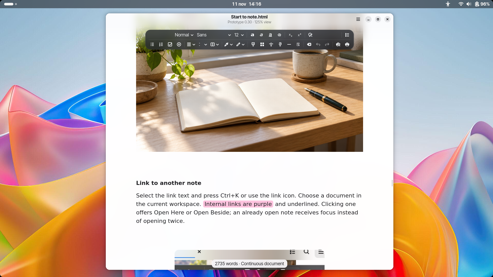

# Webkit-GN

A native GNOME word processor built with **GTK4, libadwaita, WebKitGTK 6 and
ProseMirror**. Write on a continuous document surface, format your text with a
floating toolbar, and save self-contained HTML files locally.



## Features

- A two-row floating toolbar, compact menus, and light, dark and mixed themes.
- Optional blur with adjustable opacity and intensity for the header and toolbar.
  Native menu blur requires GTK 4.24+ and GNOME 51+ on Wayland; menus remain
  solid on older GTK versions or X11.
- Body, Title and H1–H3 styles, plus custom styles you can create, rename and
  delete. Deleting a custom style returns affected text to its built-in style;
  undo restores it.
- Font search, font sizes, emphasis, subscript, superscript, alignment and
  paragraph line spacing, including 0.95.
- Matching 60-colour text and highlight palettes. Rounded highlights choose
  contrasting text automatically.
- Bulleted and numbered lists, interactive checklists, links and horizontal rules.
- Editable tables with header rows, borders, width and text-wrapping controls,
  plus rounded, coloured text boxes.
- Embedded images with proportional sizing, drag handles, a live size readout,
  Escape cancellation and one-step undo.
- One-, two- and three-column sections. A manual page break ends the current
  column layout; following text returns to full width.
- Search and replace, a live document outline, and undo/redo.
- Document margins saved with HTML, native printing, and an embedded PDF preview
  with page navigation, paper size and orientation controls.

**Supported formats:** open and save `.html` and `.htm`; export PDF through the
print dialog. DOCX and ODT conversion are not implemented. Editing uses a
continuous surface rather than automatic page boundaries; print preview shows
paginated output. A print-only column layout works around WebKit's CSS-column
printing limitations.

## Install and run

### Flatpak bundle

Download the latest successful build from
[Actions → Flatpak bundle](https://github.com/paullinux-gn/Webkit-GN/actions/workflows/flatpak.yml).
Open the completed run, download the **Webkit-GN-flatpak-x86_64** artifact, and
extract the ZIP. From the extracted directory, install and launch:

```sh
flatpak install --user Webkit-GN.flatpak
flatpak run io.github.paullinux_gn.WebkitGN
```

To replace an existing installation with a newer bundle:

```sh
flatpak install --user --reinstall Webkit-GN.flatpak
```

Fully close and reopen the app after updating. These bundles are distributed
through GitHub Actions; the app is not submitted to Flathub by this workflow.

### Run from source on CachyOS or Arch Linux

```sh
sudo pacman -Syu --needed gtk4 libadwaita webkitgtk-6.0 python python-gobject poppler
git clone https://github.com/paullinux-gn/Webkit-GN.git
cd Webkit-GN
./run.sh
```

Run inside your desktop session. The compiled JavaScript bundle is included;
Node.js, npm and Rust are not required to run the app.

## Margins, zoom and printing

Choose **Main menu → Page margins…** or press **Ctrl+Shift+M** to set the top,
bottom, left and right margins in millimetres. Each margin accepts **0–90 mm**;
the default is **20 mm**. Click **Apply**, then save the document to retain the
settings. Margin changes support undo and redo. HTML exports preserve the
settings and include browser print-margin rules.

The native Print dialog starts with the document's margins. Its **Margins** tab
lets you adjust them for that print job without changing the saved document.
Choose **Update preview** after changing print settings, then check the preview
before printing or saving a PDF.

The default editing view is **125% at A4 width**. Zoom scales the page and its
margins together and does not change the printed margin values. Toolbar clearance
sits outside the document, rather than adding to its top margin. Screen
millimetres depend on your monitor and desktop scaling; use print preview to
check placement on the physical page.

Font size and line spacing affect wrapping, line height and page count, while
the margin settings define the text area's boundary. Paragraph and heading
spacing can add visible space between that boundary and the letters.

## Appearance and language

Open **Main menu → Interface…** to choose a theme and adjust translucency.
The default appearance uses a light document and header with a dark toolbar;
blur is off. Interface preferences are saved between launches.

The app and its GTK/WebKit controls use **English**, while preserving regional
date and number preferences. External desktop portals, including the system file
picker, may use your desktop language.

Native menu blur is available with the GNOME 51 Flatpak runtime on a compatible
Wayland desktop. On older GTK versions or X11, the header and toolbar retain
the document blur fallback. Turning blur off restores solid menu backgrounds.

## Keyboard shortcuts

| Action | Shortcut |
|---|---|
| New / Open / Save | Ctrl+N / Ctrl+O / Ctrl+S |
| Save as | Ctrl+Shift+S |
| Find / Replace | Ctrl+F / Ctrl+H |
| Document outline | Ctrl+Shift+O |
| Page margins | Ctrl+Shift+M |
| Insert page break | Ctrl+Enter |
| Print / Print preview | Ctrl+P / Ctrl+Shift+P |
| Leave table below / above | Alt+Enter / Alt+Shift+Enter |
| Undo / Redo | Ctrl+Z / Ctrl+Shift+Z |

Double-click an image to open its size controls, or click once to show drag
handles. Use a table's properties handle or the toolbar table button to edit or
delete it.

## Build a Flatpak

On CachyOS or Arch Linux:

```sh
sudo pacman -S --needed flatpak flatpak-builder
./scripts/build-flatpak.sh
```

The script adds the Flathub remote for your user, downloads the GNOME 51 SDK and
runtime, builds pinned PDF-preview utilities, and creates
**`dist/Webkit-GN.flatpak`**. The first build downloads a substantial SDK;
subsequent builds reuse the cache. Ordinary editing does not require GNOME 51
on the host desktop. The manifest installs the checked-in production JavaScript
bundle, so no Node.js or Rust build is needed.

Install the result:

```sh
flatpak install --user dist/Webkit-GN.flatpak
flatpak run io.github.paullinux_gn.WebkitGN
```

Use `./scripts/build-flatpak.sh --install` to build and install in one step.
Alternatively, run **Actions → Flatpak bundle → Run workflow** on GitHub. The
workflow also runs after packaging or application changes on `main`.

### Sandbox and file access

The Flatpak uses native file portals, Wayland/X11, GPU rendering and the CUPS
socket for printing. It has no blanket home-directory access or network grant.
Use an `.html` or `.htm` extension when saving. Embedded images are preserved;
relative images in neighbouring files may be inaccessible unless separately
permitted. Settings use Flatpak's private configuration directory.

## Development and checks

Development requires Node.js 22+ and Python 3:

```sh
npm ci --prefix webkit
npm test --prefix webkit
python3 -m unittest discover -s webkit/tests -v
npm run build --prefix webkit
npm run benchmark --prefix webkit
```

The production bundle is minified; readable source and dependency notices are
included. GitHub Actions runs unit tests and verifies that the checked-in bundle
is reproducible. GTK and WebKitGTK are required for native tests and the app.

Native regression tests also need an X11 display, XTest, ImageMagick and Poppler:

```sh
DISPLAY=:99 ./scripts/webkit-env.sh ./scripts/test-native.sh
```

Use a disposable Xvfb display. Results and screenshots go into the ignored
`.runtime/` directory. Cloud helpers support locally unpacked Debian libraries;
normal desktop installations use system packages. `scripts/setup-cloud.sh` is
optional cloud setup, separate from the desktop launch path.

The Python application shell lives in `webkit/app.py`, editor modules in
`webkit/src/`, and tests in `webkit/tests/`. See [PERFORMANCE.md](PERFORMANCE.md)
for performance measurements and cleanup notes. Full Flatpak builds require
Flathub access; the GitHub workflow builds and uploads the bundle.

## Licence and credits

See [LICENSE](LICENSE) and the [dependency notices](webkit/THIRD_PARTY.md).
The application icon is custom artwork created for Webkit-GN: a blue rounded
square with a white document and golden pen nib. The original PNG is embedded
unchanged in the scalable SVG used by GTK and the Flatpak launcher.

The monochrome symbolic fallback comes from GNOME's Adwaita icon set. Credit
belongs to the [GNOME Project](https://www.gnome.org); its licence and attribution
are included in [data/ADWAITA-LICENSE.txt](data/ADWAITA-LICENSE.txt).
